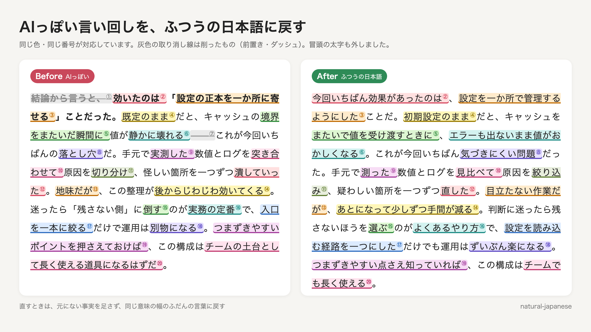

# ja-ai-style-corpus

生成AIが書く日本語に増えた言い回し(「この設定が効く」「静かに壊れる」「土台」「境界」「落とし穴」「パターンを拾う」など)を、語の表なしに見つけるためのデータとモデルです。

- **データ**: 生成AI以前の人間の文書の一覧と、同じ話題で3社の生成AIに書かせた文章 7,429本(2,444万字)。生成文には、モデル・effort・ハーネス(または API)・設定・プロンプトを1本ずつ記録しています
- **モデル**: 同じ BERT を「AI 以前の人間の文書」と「生成AIの文章」で別々に追加学習した2つのモデル。語を伏せて当てさせ、AI 時代のモデルだけがその語を置く度合いを測ります
- **わかったこと**: うまくいかなかった方法も含めて [docs/findings.md](docs/findings.md) にまとめました



## 使い方

[uv](https://docs.astral.sh/uv/) があれば、依存関係は自動で入ります。初回は Hugging Face Hub からモデルをダウンロードします。

```bash
# 文章の中で、AI 時代のモデルだけが選ぶ語を示す
uv run scripts/check.py draft.md

# 言い換えの候補を、AI 以前の人が書きそうな順に並べる(候補は人か LLM が出す)
uv run scripts/check.py --rank "この設定が効く。" 効く 影響する 有効だ 役に立つ
```

`check.py` が示すのは疑いです。新しい技術用語や話題の語、文字どおりの意味で使った語も出ます。直すかどうかは文脈で決めてください。直すときは、言い換えで意味が変わらないことを優先します(読み取れなくなる問題ではないため。[docs/findings.md](docs/findings.md))。

## データ

| ファイル | 中身 |
|---|---|
| `data/generated/generated-v1.jsonl.gz` | 生成文 7,429本。`text`(手を加えていない出力)と `text_clean`(チャットの前置きや、伏せ字だけの署名行などを除いたもの)、出どころ |
| `data/generated/sources-v1.jsonl` | 各プロンプトの元になった人間の文書の所在(本文なし) |
| `data/baseline/qiita-pre2022.jsonl` | AI 以前(2019〜2022年8月)の Qiita 記事 22,834件の一覧(本文なし) |
| `data/baseline/qiita-2026.jsonl` | 2026年8月の Qiita 記事 10,526件の一覧(本文なし) |
| `data/baseline/llmjp-explanatory-pre2022-v1.jsonl` | LLM-jp コーパス v4 から選んだ、AI 以前の説明的・実務的な Web 文章 20,301件の一覧(本文なし) |
| `data/eval/test-*.txt` | 検査に使った人間の文書の ID(学習から除いた) |
| `data/eval/generated-holdout-v0.jsonl.gz` | 検査用の生成記事100本(学習に使っていない。7モデル) |

### 生成文

**内容は架空です。** 実在の組織名・人名・製品名が出てきても、日付・数値・発表・発言などは事実ではありません。全件に `synthetic: true` と注記(`notice`)を付けています。

プロンプトは2種類で、どちらも人間の文書の話題をそのまま渡しています。

- AI 以前の Qiita 記事のタイトル: 「「{タイトル}」というタイトルで技術ブログの記事を書いて。本文は{字数}字程度で。」
- LLM-jp コーパスの AI 以前の文章の冒頭3文: 「次の内容を伝える{種類}を書いて。本文は{字数}字程度で。\n\n内容: {冒頭}」

| 書き手 | モデル | effort | ハーネス・API | 本数 |
|---|---|---|---|---|
| Anthropic | claude-opus-5-5 | low | Claude Code 2.1.296(`claude -p`) | 2,477 |
| OpenAI | gpt-6.1-sol | low | Codex CLI 0.162.1(`codex exec`) | 2,475 |
| Google | gemini-3.8-flash | low(thinkingLevel) | Gemini API v1beta Batch(`batchGenerateContent`) | 2,477 |

CLI は実行者の個人設定(ユーザー設定・ルール・AGENTS.md・プラグイン)を読まない環境で動かし、システムプロンプトは各 CLI の標準のままにしました。正確なバージョンと設定は各行の `harness_version`・`settings` にあります。作り方は `scripts/generate.py` です。

最初の生成分(`batch: "prod"`、2,975本)は、出どころを記録する仕組みを作る前に書かせたもので、記録は同じ設定で後から付けました(`backfilled: true`。`harness_version` は記録した日に確かめたもの)。Gemini の分は、保存した応答から `model_version` と `usage` を取っています。

### 人間の文書

人間の文書の本文は含めていません(著作権は書いた人にあります)。一覧から取り出すスクリプトを置いています。

```bash
# Qiita(アクセストークンが要る。https://qiita.com/settings/applications)
QIITA_TOKEN=... uv run scripts/fetch_qiita.py --list data/baseline/qiita-pre2022.jsonl --out work/qiita-pre2022.jsonl.gz

# LLM-jp コーパス v4(配布元からファイルを流し読みする。1ファイルで数分)
uv run scripts/fetch_llmjp.py --list data/baseline/llmjp-explanatory-pre2022-v1.jsonl --out work/llmjp.jsonl
```

本文は一覧の SHA-256 と照合します。作者が後から記事を直したり、削除したりしていれば、一致しないか取り出せません。

## モデル

[coji/ja-ai-style-bert](https://huggingface.co/coji/ja-ai-style-bert) に2つのモデルを置いています(`pre-ai/`・`ai-era/`、各212MB、fp16)。

| | pre-ai | ai-era |
|---|---|---|
| 事前学習済みモデル | tohoku-nlp/bert-base-japanese-v3 | 同じ |
| 追加学習のデータ | 生成のプロンプトの元になった人間の文書(Qiita 2019〜2021年8月の記事、LLM-jp コーパスの AI 以前の文章)1,331万字 | 生成文の `text_clean` から文を無作為に選び、同じ字数にそろえたもの |
| 学習 | 2,500ステップ(約1.8周)、バッチ32、系列長256、語単位の伏せ字15%、学習率 5e-5(warmup 6%、weight decay 0.01)、fp32、seed 0 | 同じ |

学習には Apple M5 Pro(64GB、MPS)で1つ約50分かかりました。LoRA(差分だけの学習)も試しましたが、検出の力が大きく落ちたので使っていません([docs/findings.md](docs/findings.md))。

### 学習し直す

```bash
QIITA_TOKEN=... uv run scripts/fetch_qiita.py --list data/baseline/qiita-pre2022.jsonl \
    --only data/generated/sources-v1.jsonl --out work/qiita-sources.jsonl.gz
uv run scripts/fetch_llmjp.py --list data/generated/sources-v1.jsonl --out work/llmjp-sources.jsonl
uv run scripts/train.py prepare --qiita work/qiita-sources.jsonl.gz --llmjp work/llmjp-sources.jsonl
uv run scripts/train.py train pre-ai
uv run scripts/train.py train ai-era
uv run scripts/check.py draft.md --models models/local
```

検査用の文書での数値は `scripts/score.py` で出せます。

## ライセンス

- コード(`scripts/`): MIT
- 生成文(`data/generated/`、`data/eval/generated-holdout-v0.jsonl.gz`): CC BY 4.0。プロンプトに含まれる人間の文書の一部(Qiita のタイトル、LLM-jp コーパスの文章の冒頭)の権利は、元の書き手にあります
- 一覧(`data/baseline/`、`data/eval/test-*.txt`、`sources-v1.jsonl`): CC BY 4.0。LLM-jp コーパス由来の項目は、元のコーパスのライセンス(ODC-BY・CC BY 4.0)にも従ってください
- モデル: Apache-2.0(元の [tohoku-nlp/bert-base-japanese-v3](https://huggingface.co/tohoku-nlp/bert-base-japanese-v3) と同じ)

生成文の利用は、各モデルの利用規約の範囲で行ってください。

## 参考

- 逆瀬川「[Qiita 7万記事で見る生成AI以前・以後の文章の変化](https://nyosegawa.com/posts/qiita-writing-before-after-ai/)」: AI 以前と以後の Qiita の比較。年ごとの記事の集め方はこの調査に合わせました
- [LLM-jp コーパス v4](https://gitlab.llm-jp.nii.ac.jp/datasets/llm-jp-corpus-v4)(国立情報学研究所 LLM-jp)
